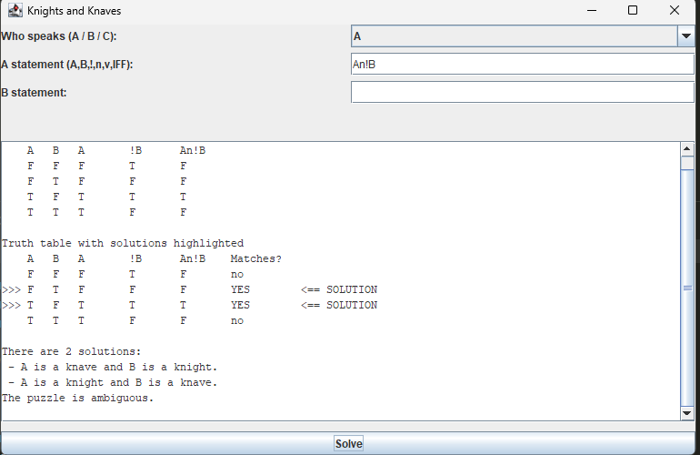

Knight and Knaves Puzzle Solver (Java)

## Objective

Automate knight-and-knave puzzles: knights always speak truly, knaves always lie.

## Statement symbols

| Symbol | Meaning        |
|--------|----------------|
| A, B   | A / B is a knight |
| !      | NOT            |
| n      | AND            |
| v      | OR             |
| IFF    | implication (X IFF Y means if X then Y) |

Precedence: OR (`v`), then AND (`n`), then IFF. Example: `AIFFB` means if A is a knight then B is a knight.

## Run

```bash
cd src
javac app/*.java
java app.Main
```

Opens a small Swing window: enter who speaks and statements, click **Solve**. Console: `java app.Main --cli`

## Layout

- `Main.java` — UI or `--cli`
- `SimpleUI.java` — minimal input + output area
- `Input.java` — tasks 1–2 (setup input)
- `TruthTable.java` — task 3 (table + statement evaluation)
- `Evaluation.java` — task 4 (knight/knave check per row)
- `Verdict.java` — tasks 5–6 (highlight + English verdict)


