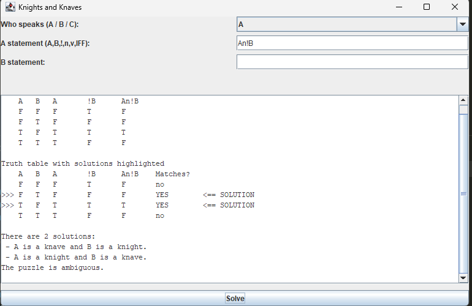

Romaric (3 tasks)

1. Set up the project

Create the project folder and the main files.
Decide the notation everyone will use: A, B, NOT, AND, OR.
Agree on how data is shared (see "Shared agreement" below).
Done when: everyone can run the empty program and add their function.

2. getValidInput

Ask who is speaking (A, B, or BOTH).
Ask for each speaker's statement.
Check the statement is readable (only allowed words, brackets balanced). If not, ask again.
Done when: the function gives back who speaks and the statement text(s), and never accepts garbage.

3. buildTruthTable

Build the 4 situations (A and B each true or false).
For each situation, work out the statement's value using evaluate.
Print the plain truth table
Done when: the table shows all 4 rows with the statement values.

Enoch (1 task)

4. evaluateSolution

For each row, check that each speaker's type matches their statement's value (knight with a true statement, or knave with a false statement).
Mark the row with a solution(s) or not.

Verone (2 tasks)

5. highlightValidSolutions

Reprint the truth table with a "matches?" column.
Mark solution rows
Done when: solution rows stand out and non-solution rows look normal.

6. printVerdict

No solutions: print "There is no solution."
One solution: print it in plain English, e.g. "A is a knave and B is a knight."
Several solutions: list them all and say the puzzle is ambiguous.
Done when: all three outcomes print a clear sentence.

Ouput
